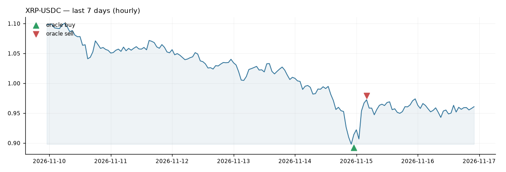
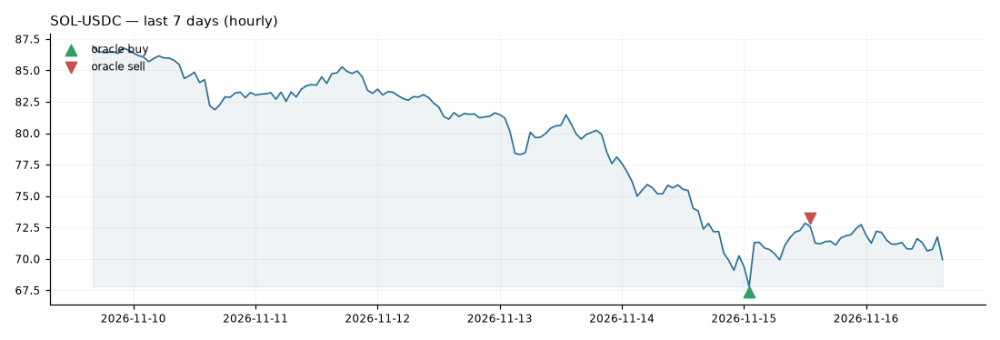

# ATLAS Oracle Tracker

Live hindsight-**oracle** analytics for 13 liquid USDC perpetuals,
refreshed automatically by GitHub Actions from public exchange candle
data.

The **oracle** for a window is the best trade that existed in hindsight:
buy at the lowest hourly low, sell at the highest hourly high after it.
Comparing today's oracle against buy&hold shows how much opportunity the
week actually contained, per coin — a benchmark for any systematic
strategy.

> These numbers are computed with hindsight and are **not investable**.
> Nothing here is financial advice.

**Last update:** Nov 14 2026 17:06 UTC — 13/13 coins rendered

| Pair | 24h oracle | 7d oracle | 7d buy&hold | oracle window |
|---|---|---|---|---|
| BTC-USDC | +1.6% | +3.8% | -13.3% | Nov 13 05:00 → Nov 13 13:00 UTC |
| ETH-USDC | +2.3% | +4.9% | -17.7% | Nov 10 15:00 → Nov 11 17:00 UTC |
| XRP-USDC | +2.1% | +4.8% | -16.3% | Nov 10 15:00 → Nov 11 17:00 UTC |
| SOL-USDC | +1.9% | +5.7% | -17.6% | Nov 13 03:00 → Nov 13 13:00 UTC |
| ZEC-USDC | +4.0% | +13.0% | -30.0% | Nov 13 05:00 → Nov 13 13:00 UTC |
| ADA-USDC | +1.9% | +7.2% | -13.6% | Nov 08 21:00 → Nov 09 15:00 UTC |
| XLM-USDC | +2.6% | +8.4% | -8.1% | Nov 10 15:00 → Nov 11 16:00 UTC |
| LTC-USDC | +2.2% | +6.1% | -11.6% | Nov 08 21:00 → Nov 09 15:00 UTC |
| LINK-USDC | +2.3% | +6.9% | -14.6% | Nov 08 21:00 → Nov 09 15:00 UTC |
| NEAR-USDC | +2.8% | +11.5% | -11.8% | Nov 13 05:00 → Nov 13 13:00 UTC |
| DOGE-USDC | +2.1% | +5.7% | -14.9% | Nov 08 21:00 → Nov 09 15:00 UTC |
| ONDO-USDC | +2.6% | +14.3% | -13.4% | Nov 08 21:00 → Nov 09 16:00 UTC |
| SUI-USDC | +2.4% | +8.3% | -13.7% | Nov 13 05:00 → Nov 13 13:00 UTC |

## Charts (7-day window, oracle entry/exit marked)

