# ATLAS Oracle Tracker

Live hindsight-**oracle** analytics for 13 liquid USDC perpetuals,
refreshed automatically by GitHub Actions from public exchange candle
data.

The **oracle** for a window is the best trade that existed in hindsight:
buy at the lowest hourly low, sell at the highest hourly high after it.
Comparing today's oracle against buy&hold shows how much opportunity the
week actually contained, per coin — a benchmark for any systematic
strategy.

> These numbers are computed with hindsight and are **not investable**.
> Nothing here is financial advice.

**Last update:** Oct 19 2026 01:16 UTC — 13/13 coins rendered

| Pair | 24h oracle | 7d oracle | 7d buy&hold | oracle window |
|---|---|---|---|---|
| BTC-USDC | +2.3% | +4.0% | -1.5% | Oct 15 13:00 → Oct 16 11:00 UTC |
| ETH-USDC | +3.9% | +7.7% | -5.0% | Oct 15 02:00 → Oct 16 11:00 UTC |
| XRP-USDC | +4.3% | +5.8% | -6.9% | Oct 13 00:00 → Oct 14 08:00 UTC |
| SOL-USDC | +4.1% | +7.3% | -6.5% | Oct 13 00:00 → Oct 13 07:00 UTC |
| ZEC-USDC | +10.2% | +16.8% | -9.8% | Oct 15 06:00 → Oct 15 21:00 UTC |
| ADA-USDC | +5.4% | +8.1% | -11.4% | Oct 15 02:00 → Oct 16 11:00 UTC |
| XLM-USDC | +4.2% | +5.5% | -11.3% | Oct 15 02:00 → Oct 15 15:00 UTC |
| LTC-USDC | +4.6% | +7.7% | -8.6% | Oct 15 02:00 → Oct 16 00:00 UTC |
| LINK-USDC | +5.3% | +8.1% | -9.5% | Oct 15 13:00 → Oct 16 11:00 UTC |
| NEAR-USDC | +9.3% | +20.3% | -13.5% | Oct 15 13:00 → Oct 15 19:00 UTC |
| DOGE-USDC | +4.7% | +7.1% | -8.3% | Oct 13 00:00 → Oct 14 08:00 UTC |
| ONDO-USDC | +6.7% | +13.1% | -16.6% | Oct 15 13:00 → Oct 16 11:00 UTC |
| SUI-USDC | +7.1% | +10.6% | -10.5% | Oct 15 13:00 → Oct 16 11:00 UTC |

## Charts (7-day window, oracle entry/exit marked)

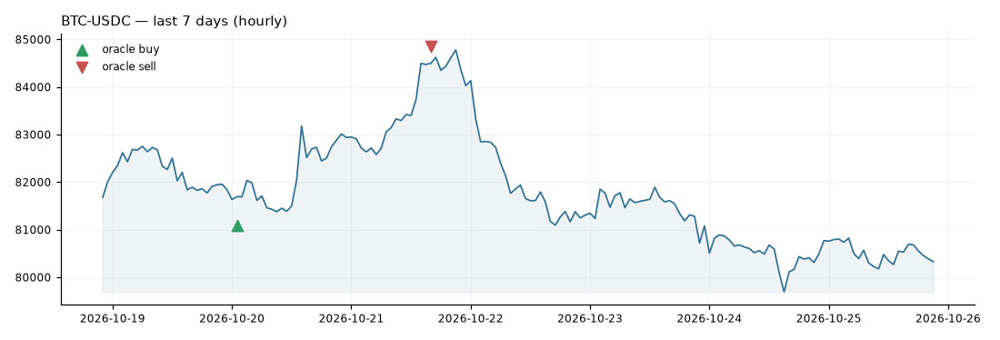

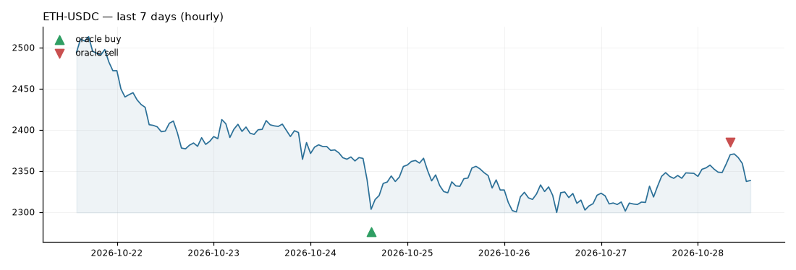

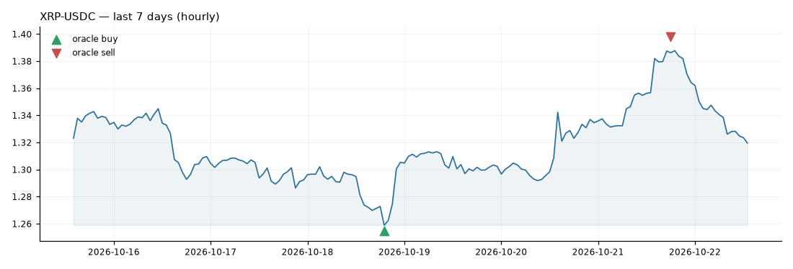

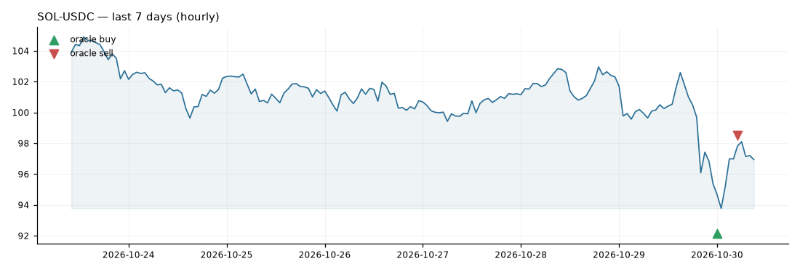

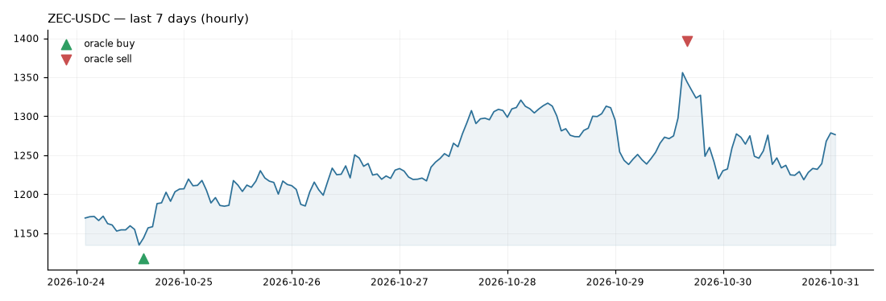

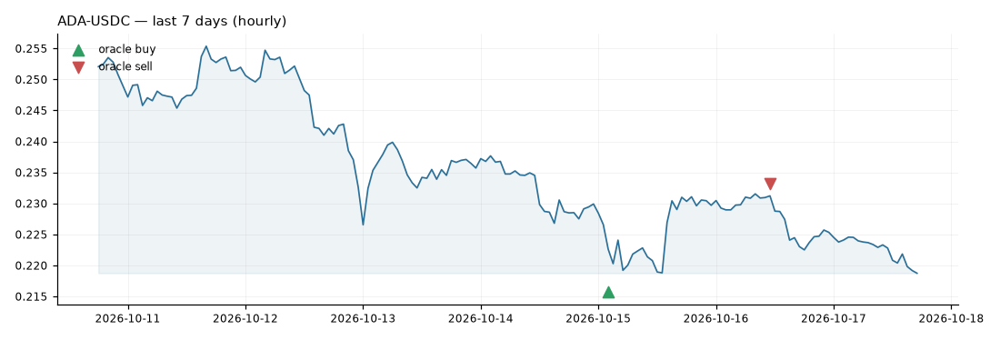

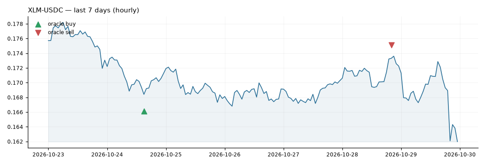

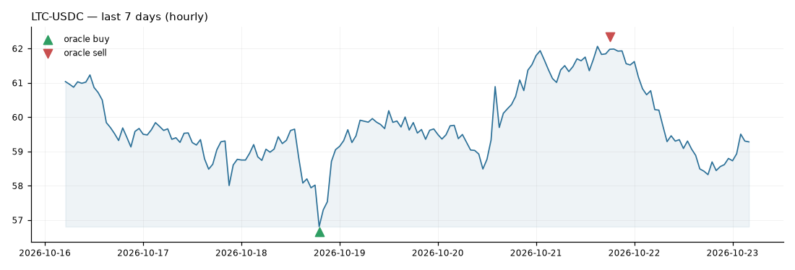

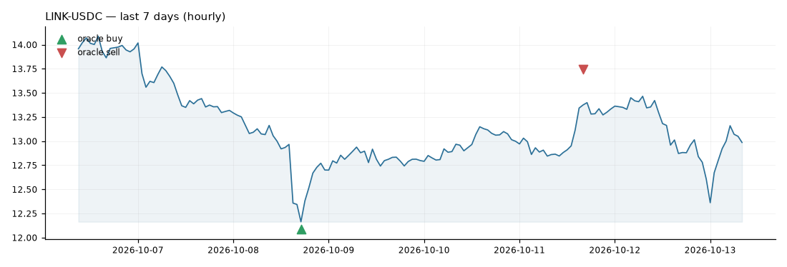

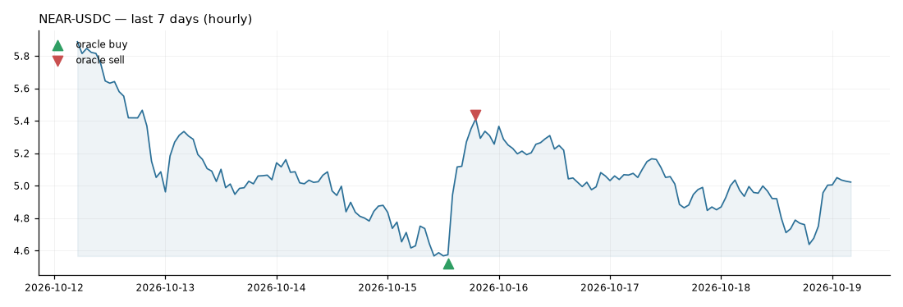

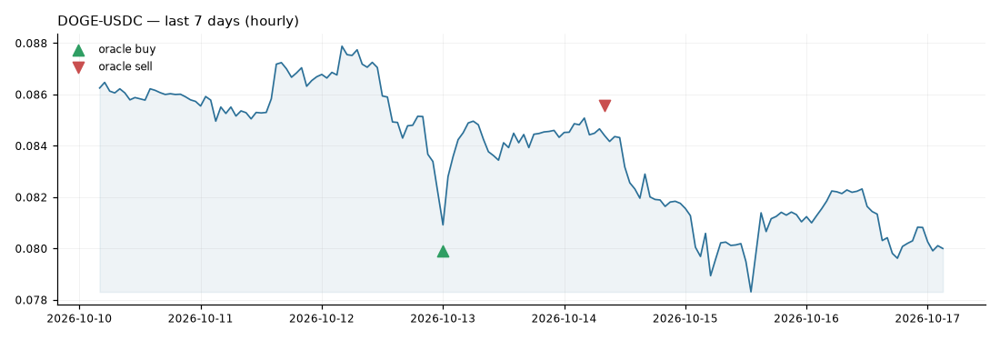

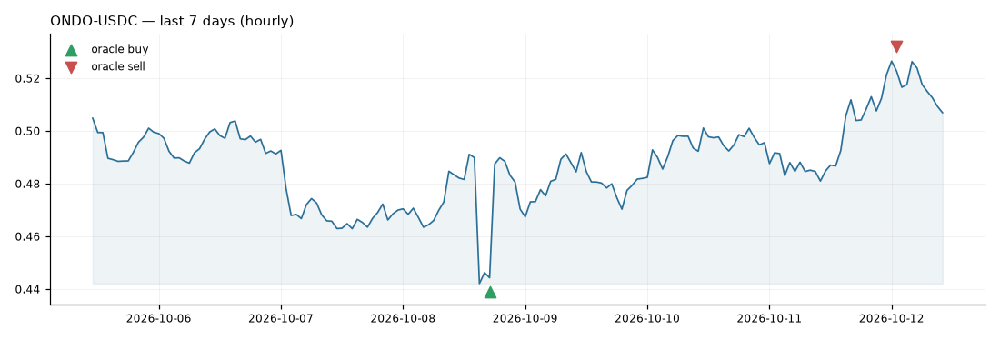

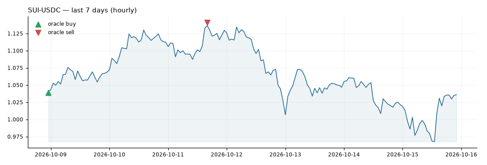

