# ATLAS Oracle Tracker

Live hindsight-**oracle** analytics for 13 liquid USDC perpetuals,
refreshed automatically by GitHub Actions from public exchange candle
data.

The **oracle** for a window is the best trade that existed in hindsight:
buy at the lowest hourly low, sell at the highest hourly high after it.
Comparing today's oracle against buy&hold shows how much opportunity the
week actually contained, per coin — a benchmark for any systematic
strategy.

> These numbers are computed with hindsight and are **not investable**.
> Nothing here is financial advice.

**Last update:** Nov 04 2026 07:38 UTC — 13/13 coins rendered

| Pair | 24h oracle | 7d oracle | 7d buy&hold | oracle window |
|---|---|---|---|---|
| BTC-USDC | +3.3% | +3.4% | -4.2% | Oct 30 18:00 → Nov 02 03:00 UTC |
| ETH-USDC | +3.7% | +6.7% | -3.1% | Oct 30 01:00 → Nov 02 03:00 UTC |
| XRP-USDC | +3.4% | +7.7% | -4.3% | Oct 30 01:00 → Nov 03 13:00 UTC |
| SOL-USDC | +3.9% | +6.9% | -9.5% | Oct 30 00:00 → Oct 30 05:00 UTC |
| ZEC-USDC | +13.7% | +14.2% | -3.2% | Nov 03 05:00 → Nov 04 06:00 UTC |
| ADA-USDC | +4.7% | +8.1% | -8.1% | Oct 30 00:00 → Oct 31 00:00 UTC |
| XLM-USDC | +4.1% | +9.3% | -5.5% | Oct 30 00:00 → Oct 30 15:00 UTC |
| LTC-USDC | +4.5% | +6.9% | -5.7% | Oct 30 00:00 → Oct 30 06:00 UTC |
| LINK-USDC | +4.3% | +16.4% | -6.4% | Oct 30 00:00 → Oct 31 20:00 UTC |
| NEAR-USDC | +7.4% | +16.8% | -16.5% | Oct 30 00:00 → Oct 31 18:00 UTC |
| DOGE-USDC | +3.9% | +6.3% | -6.8% | Oct 30 00:00 → Oct 30 06:00 UTC |
| ONDO-USDC | +6.5% | +17.2% | -4.7% | Oct 30 00:00 → Oct 31 01:00 UTC |
| SUI-USDC | +5.1% | +10.3% | -4.7% | Oct 30 00:00 → Oct 31 00:00 UTC |

## Charts (7-day window, oracle entry/exit marked)

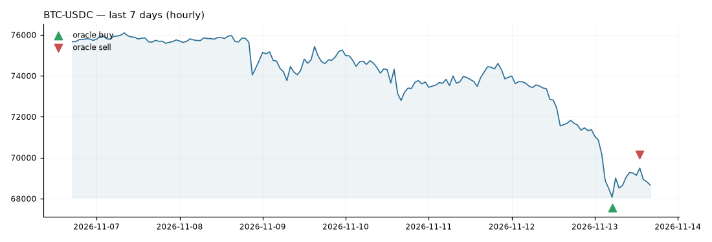

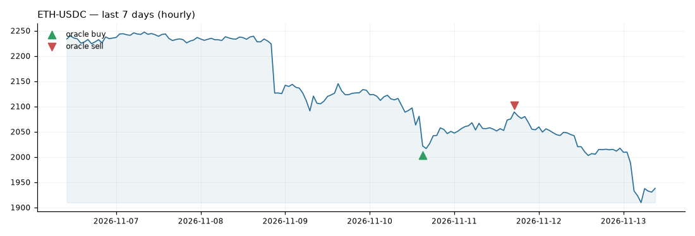

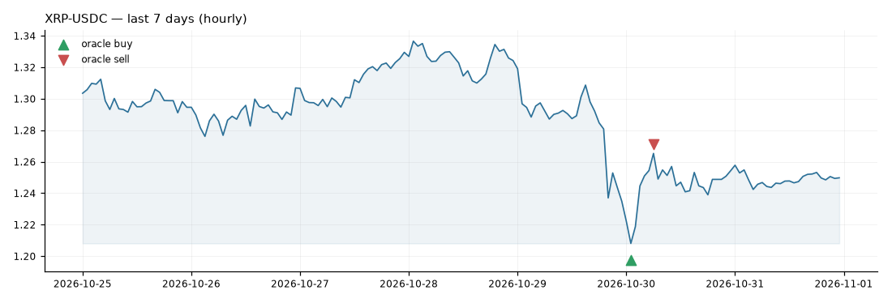

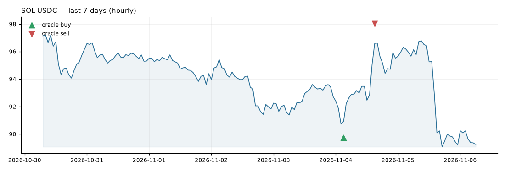

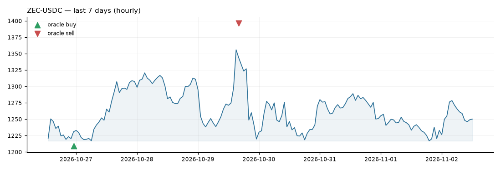

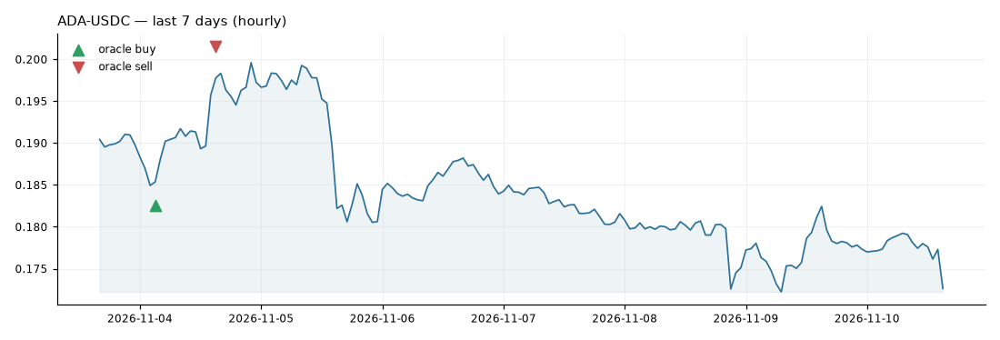

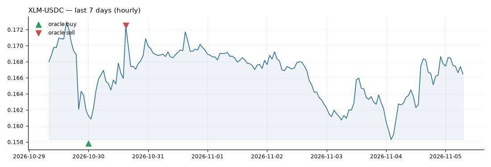

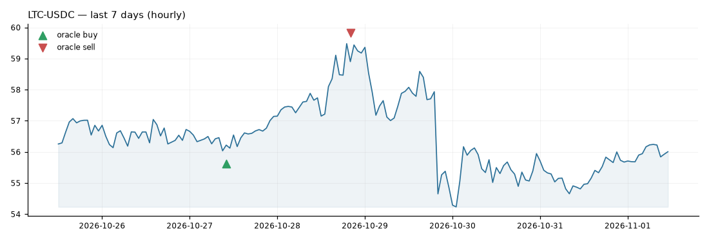

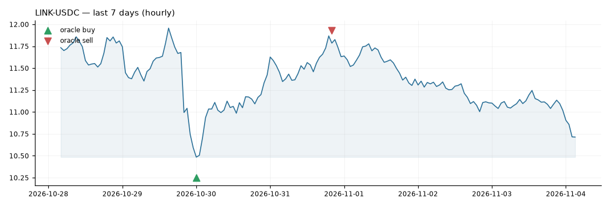

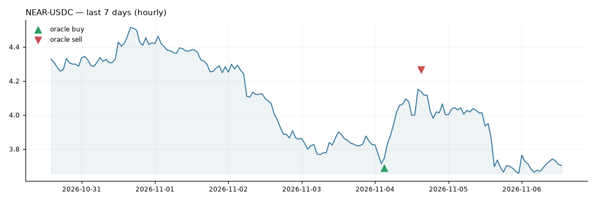

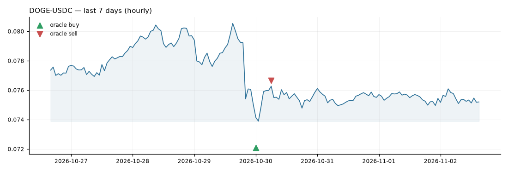

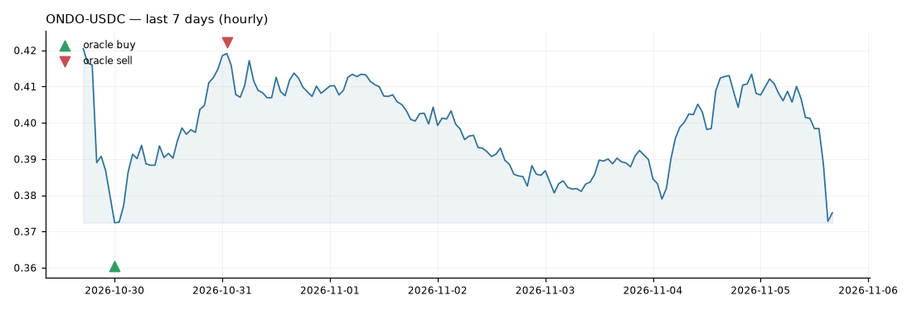

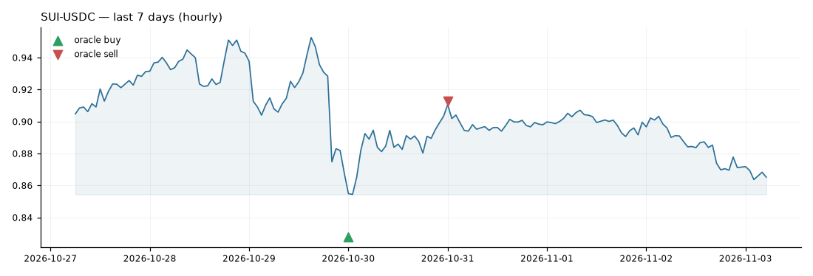

