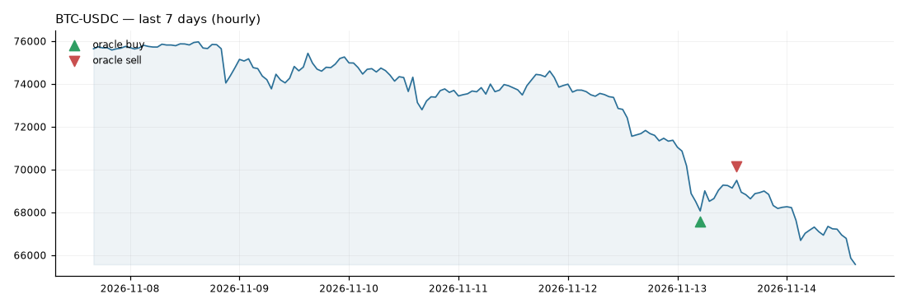
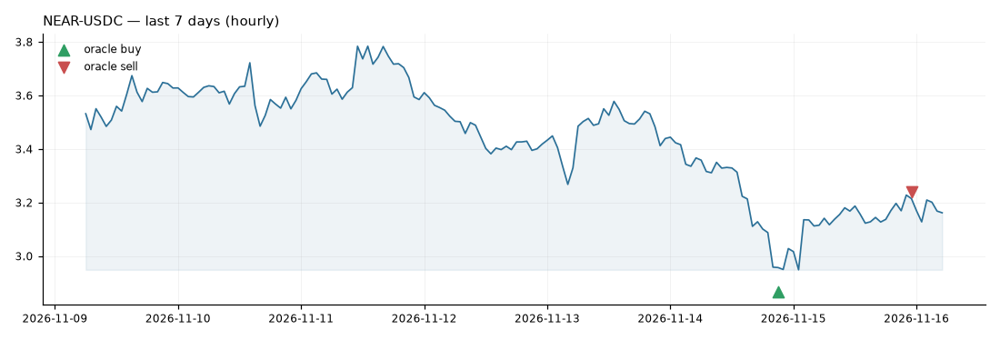
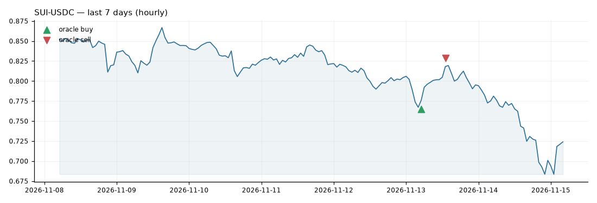

# ATLAS Oracle Tracker

Live hindsight-**oracle** analytics for 13 liquid USDC perpetuals,
refreshed automatically by GitHub Actions from public exchange candle
data.

The **oracle** for a window is the best trade that existed in hindsight:
buy at the lowest hourly low, sell at the highest hourly high after it.
Comparing today's oracle against buy&hold shows how much opportunity the
week actually contained, per coin — a benchmark for any systematic
strategy.

> These numbers are computed with hindsight and are **not investable**.
> Nothing here is financial advice.

**Last update:** Nov 15 2026 04:53 UTC — 13/13 coins rendered

| Pair | 24h oracle | 7d oracle | 7d buy&hold | oracle window |
|---|---|---|---|---|
| BTC-USDC | +5.8% | +5.8% | -14.3% | Nov 15 01:00 → Nov 15 03:00 UTC |
| ETH-USDC | +7.2% | +7.2% | -18.5% | Nov 15 01:00 → Nov 15 03:00 UTC |
| XRP-USDC | +9.5% | +9.5% | -15.9% | Nov 14 23:00 → Nov 15 04:00 UTC |
| SOL-USDC | +6.9% | +6.9% | -19.7% | Nov 15 01:00 → Nov 15 03:00 UTC |
| ZEC-USDC | +16.2% | +16.2% | -27.4% | Nov 14 21:00 → Nov 15 03:00 UTC |
| ADA-USDC | +6.5% | +7.2% | -16.1% | Nov 08 21:00 → Nov 09 15:00 UTC |
| XLM-USDC | +6.6% | +8.4% | -7.4% | Nov 10 15:00 → Nov 11 16:00 UTC |
| LTC-USDC | +5.9% | +6.1% | -14.0% | Nov 08 21:00 → Nov 09 15:00 UTC |
| LINK-USDC | +7.3% | +7.3% | -14.7% | Nov 14 22:00 → Nov 15 03:00 UTC |
| NEAR-USDC | +10.5% | +11.5% | -15.3% | Nov 13 05:00 → Nov 13 13:00 UTC |
| DOGE-USDC | +6.8% | +6.8% | -17.2% | Nov 14 22:00 → Nov 15 03:00 UTC |
| ONDO-USDC | +7.2% | +14.3% | -15.2% | Nov 08 21:00 → Nov 09 16:00 UTC |
| SUI-USDC | +7.5% | +8.3% | -15.0% | Nov 13 05:00 → Nov 13 13:00 UTC |

## Charts (7-day window, oracle entry/exit marked)

